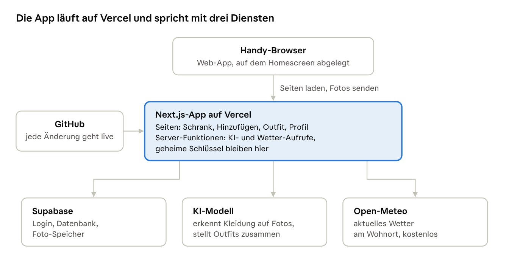

# KI-Kleiderschrank – Produkt- und Entwicklungsplan

Stand: 27.11.2026 · Quelle: [Claude Doc](https://claude.ai/artifact/N1isAB2aP6cpBNKjfAzX6Z)

Unsere Empfehlung: Wir bauen zuerst eine mobil optimierte Web-App (läuft im Handy-Browser und lässt sich wie eine App auf den Homescreen legen), mit Supabase als Backend und einem einzigen KI-Modell für Bilderkennung und Outfit-Vorschläge. Das MVP ist in 9 klar abgegrenzten Phasen (0 bis 8) umsetzbar. Dieses Dokument ist ein Entwurf zur Abstimmung: Bitte kommentiert direkt an den Stellen, die ihr anders seht. Die offenen Entscheidungen stehen gesammelt am Ende.

## 1. Produktkonzept

**Nutzenversprechen in einem Satz:** „Dein Kleiderschrank in der Hosentasche, der dir jeden Morgen sagt, was du aus deinen eigenen Sachen anziehen kannst.“

Die App ist ein persönlicher, digitaler Kleiderschrank. Nutzerinnen und Nutzer fotografieren ihre Kleidungsstücke, die KI erkennt Art, Farbe, Muster, Material und Stil und sortiert sie automatisch ein. Aus diesem Bestand stellt ein KI-Outfit-Generator passende Kombinationen für Anlass, Wetter und Stil zusammen, und zwar ausschließlich aus Kleidung, die man wirklich besitzt.

Drei Dinge unterscheiden die App von Shopping- und Inspirations-Apps:

- **Nur eigene Kleidung.** Es gibt keine Kaufempfehlungen und keine Werbung. Der Fokus liegt darauf, mehr aus dem Vorhandenen zu machen.
- **Wenig Aufwand beim Erfassen.** Foto machen, KI füllt alles aus, kurz prüfen, fertig. Ziel: unter 20 Sekunden pro Teil.
- **Konkrete Entscheidungshilfe.** Statt „Lass dich inspirieren“ bekommt man in zwei Taps drei fertige Outfits für heute.

**Erfolgskriterium für das MVP:** Eine Testperson erfasst mindestens 20 Teile und bekommt danach ein Outfit, das sie tatsächlich anziehen würde.

## 2. Zielgruppen

Primäre Zielgruppe für das MVP sind Studierende und Berufseinsteiger zwischen 18 und 30. Sie sind smartphone-affin, haben wechselnde Anlässe (Uni, Nebenjob, Party, Date) und ein begrenztes Budget. Die anderen Gruppen bedienen wir später mit Zusatzfunktionen.

| Zielgruppe | Situation | Bedürfnis | Was die App dafür leistet |
| --- | --- | --- | --- |
| Studierende, 18–25 (MVP-Fokus) | Volle Woche, wenig Zeit morgens, viele Anlässe | Schnell entscheiden, trotzdem gut aussehen | Outfit für „Uni, 15 Grad, Casual“ in zwei Taps |
| Berufseinsteiger, 23–30 | Neuer Job, Dresscode unklar | Passende Business-Casual-Looks aus vorhandener Kleidung | Anlass „Arbeit“, Stilfilter „Elegant“ |
| Nachhaltig Orientierte | Wollen weniger kaufen | Vorhandenes besser nutzen, Fehlkäufe vermeiden | Übersicht, neue Kombinationen, später Tragestatistik |
| Mode-Interessierte | Großer Kleiderschrank, eigener Stil | Ordnung, Inspiration, Lookbook | Filter, Favoriten, gespeicherte Outfits |
| Pendler und Reisende (später) | Packen für mehrere Tage | Capsule-Wardrobe für eine Reise | Spätere Funktion „Packliste“ |

**Gemeinsame Schmerzpunkte:** „Ich habe nichts anzuziehen“ trotz vollem Schrank, vergessene Teile ganz hinten, Unsicherheit bei Farbkombinationen und Zeitdruck am Morgen.

## 3. Funktionsübersicht

Alle Funktionen aus eurem Briefing plus einige Ergänzungen, gruppiert nach Bereich. Die Spalte „Version“ zeigt, ob eine Funktion ins MVP gehört oder später kommt (Details in Abschnitt 4).

| Bereich | Funktion | Version |
| --- | --- | --- |
| Konto | Registrierung und Login per E-Mail | MVP |
| Konto | Login mit Google oder Apple | Später |
| Onboarding | Lieblingsstile, Lieblingsfarben, No-Gos, typische Anlässe abfragen | MVP |
| Onboarding | Wohnort für das Wetter (oder Standortfreigabe) | MVP |
| Kleiderschrank | Foto aufnehmen oder aus der Galerie hochladen | MVP |
| Kleiderschrank | KI erkennt Kategorie, Unterkategorie, Farbe, Muster, Material, Stil | MVP |
| Kleiderschrank | KI schlägt Jahreszeit, Anlass und Wärmegrad vor | MVP |
| Kleiderschrank | Erkannte Angaben manuell korrigieren | MVP |
| Kleiderschrank | Raster-Ansicht aller Teile, gruppiert nach Kategorie | MVP |
| Kleiderschrank | Detailseite, Teil bearbeiten und löschen | MVP |
| Kleiderschrank | Hintergrund automatisch entfernen (freigestellte Teile) | Später, Phase 8 optional |
| Kleiderschrank | Mehrere Teile auf einem Foto erkennen | Später |
| Filter und Suche | Filter nach Kategorie, Farbe, Jahreszeit, Anlass, Stil | MVP |
| Filter und Suche | Filter nach Wetter (warm, kalt, Regen) | MVP |
| Filter und Suche | Freitextsuche („blaue Jeans“) | Später |
| Outfit-Generator | Anlass, Wetter und Stil wählen | MVP |
| Outfit-Generator | Aktuelles Wetter automatisch laden | MVP |
| Outfit-Generator | 3 Outfit-Vorschläge mit kurzer Begründung | MVP |
| Outfit-Generator | Einzelnes Teil austauschen | MVP |
| Outfit-Generator | Outfit speichern und favorisieren | MVP |
| Outfit-Generator | Daumen hoch / runter, KI lernt daraus | Später |
| Outfit-Generator | Outfit manuell selbst zusammenstellen | Später |
| Profil | Stilpräferenzen nachträglich ändern | MVP |
| Profil | Konto und alle Daten löschen (DSGVO) | MVP |
| Erweiterungen | Outfit-Kalender und Tragehistorie („zuletzt getragen“) | Später |
| Erweiterungen | Statistik: meistgetragen, nie getragen | Später |
| Erweiterungen | Packliste für Reisen | Später |
| Erweiterungen | Outfits teilen, Freunde | Später |
| Erweiterungen | Native App in App Store und Play Store | Später |

## 4. MVP: Was die erste Version unbedingt braucht

Das MVP beweist eine einzige Kette: **Foto hochladen → KI sortiert ein → KI schlägt ein tragbares Outfit vor.** Alles, was diese Kette nicht braucht, kommt später.

**Unbedingt notwendig (MVP)**

1. Konto mit E-Mail-Login, damit jeder seinen eigenen Schrank hat und die Daten sicher getrennt sind.
2. Kurzes Onboarding mit 4 Fragen: Stile, Lieblingsfarben, No-Gos, typische Anlässe, dazu der Wohnort.
3. Foto-Upload mit KI-Erkennung und einem Prüf-Formular zum Korrigieren.
4. Kleiderschrank-Ansicht als Bilder-Raster mit Kategorie-Reitern und Filtern.
5. Outfit-Generator: Anlass, Wetter (automatisch geladen oder manuell) und Stil wählen, 3 Vorschläge mit Begründung erhalten.
6. Einzelnes Teil im Vorschlag austauschen.
7. Outfits speichern und als Favorit markieren.
8. Profil bearbeiten und Konto löschen.

**Bewusst nicht im MVP**

- Hintergrund-Freistellung: sieht schön aus, ist aber nicht nötig, um die Idee zu testen. Wir planen sie als optionalen Zusatz in Phase 8, wenn Zeit bleibt.
- Lernen aus Bewertungen, Kalender, Statistiken, Packliste, Teilen: lohnen sich erst, wenn Menschen die App regelmäßig nutzen.
- Native App im Store: kostet Gebühren und Prüfprozesse. Die Web-App lässt sich trotzdem wie eine App auf den Homescreen legen.

**Ein Hinweis zur KI:** Kategorie, Farbe und Muster erkennt die KI aus Fotos sehr zuverlässig. Material, Anlass und Jahreszeit sind nur Schätzungen, weil man sie auf einem Foto nicht sicher sieht. Deshalb ist das Prüf-Formular nach dem Upload Pflicht und kein Extra.

## 5. User Journey

Beispiel: Lena, 22, studiert in Hannover. Vom ersten Öffnen bis zum ersten KI-Outfit braucht sie etwa 10 Minuten, davon die meiste Zeit fürs Fotografieren.

1. **Entdecken und öffnen.** Lena bekommt einen Link, öffnet ihn am Handy und sieht einen ruhigen Startbildschirm: „Dein Kleiderschrank. Digital.“ Sie tippt auf „Los geht’s“.
2. **Konto anlegen.** E-Mail und Passwort, Bestätigungslink. Danach fragt die App, ob sie sich als App auf den Homescreen legen möchte.
3. **Onboarding (ca. 1 Minute).** Vier Bildschirme mit großen, antippbaren Kacheln:
   1. Welche Stile magst du? (Casual, Minimalistisch, Elegant, Sportlich, Streetwear, Boho …)
   2. Welche Farben trägst du gern, welche gar nicht?
   3. Wofür ziehst du dich meistens an? (Uni, Arbeit, Freizeit, Sport, Party, Date)
   4. Wo wohnst du? (für das Wetter)
4. **Leerer Schrank mit klarer Aufgabe.** Die App zeigt: „Füge mindestens 10 Teile hinzu, dann kann ich dir Outfits vorschlagen.“ Ein Fortschrittsbalken zählt mit.
5. **Erstes Teil erfassen.** Lena tippt auf „+“, fotografiert ihre Jeans vor einer hellen Wand. Nach 2–4 Sekunden erscheint das Prüf-Formular, bereits ausgefüllt: Hose, Jeans, Hellblau, Uni, Denim, Casual, Frühling bis Herbst. Sie korrigiert nichts und tippt „Speichern“.
6. **Weitere Teile.** Sie wiederholt das für Oberteile, Jacke, Schuhe und Tasche. Nach dem 10. Teil erscheint: „Dein erster Look wartet.“
7. **Outfit anfragen.** Im Tab „Outfit“ ist das Wetter schon geladen („Hannover, 15 °C, bewölkt“). Sie wählt Anlass „Uni“ und Stil „Casual“ und tippt „Outfits vorschlagen“.
8. **Vorschläge ansehen.** Drei Outfit-Karten zum Wischen. Jede zeigt die Teile als Collage und einen Satz Begründung, z. B. „Die Jeansjacke reicht bei 15 Grad, das cremefarbene Shirt hält den Look hell.“
9. **Anpassen.** Die Sneaker gefallen ihr nicht. Sie tippt darauf und sieht passende Alternativen aus ihrem Schrank, wählt die Stiefeletten.
10. **Speichern.** Herz antippen: Das Outfit landet unter „Gespeichert“. Am nächsten Morgen beginnt sie direkt bei Schritt 7.

## 6. Seitenstruktur

Das MVP hat 13 Seiten. Nach dem Login führt eine Leiste unten am Bildschirm zu den vier Hauptbereichen, in der Mitte sitzt ein großer „+“-Knopf zum Hinzufügen.

**Navigationsleiste:** Schrank · Outfit · **+** · Gespeichert · Profil

| Seite | Adresse in der App | Inhalt | Erreichbar über |
| --- | --- | --- | --- |
| Willkommen | / | Kurzer Pitch, Knopf „Los geht’s“, Login-Link | Erster Aufruf |
| Registrieren | /registrieren | E-Mail, Passwort | Willkommen |
| Anmelden | /anmelden | E-Mail, Passwort, Passwort vergessen | Willkommen |
| Onboarding | /onboarding | 4 Schritte: Stile, Farben, Anlässe, Wohnort | Nach der ersten Registrierung |
| Kleiderschrank | /schrank | Bilder-Raster, Kategorie-Reiter, Filter-Knopf, Fortschritt bis 10 Teile | Leiste: Schrank (Startseite nach Login) |
| Filter | /schrank (Bottom Sheet) | Kategorie, Farbe, Jahreszeit, Anlass, Stil, Wetter | Filter-Knopf im Schrank |
| Teil hinzufügen | /hinzufuegen | Kamera oder Galerie, Ladeanzeige während der KI-Analyse | Leiste: + |
| Teil prüfen | /hinzufuegen/pruefen | Foto plus vorausgefülltes Formular, Speichern | Nach der KI-Analyse |
| Teil-Details | /schrank/\[id\] | Großes Bild, alle Merkmale, Bearbeiten, Löschen, „In Outfits verwenden“ | Tippen auf ein Teil |
| Outfit-Generator | /outfit | Wetter-Karte, Anlass- und Stil-Auswahl, Knopf „Vorschlagen“ | Leiste: Outfit |
| Outfit-Vorschläge | /outfit/vorschlaege | 3 Karten zum Wischen, Teil austauschen, Herz, Neu generieren | Nach „Vorschlagen“ |
| Gespeicherte Outfits | /gespeichert | Raster der Outfits, Reiter „Alle“ und „Favoriten“ | Leiste: Gespeichert |
| Profil | /profil | Stile, Farben, Anlässe, Wohnort bearbeiten, Abmelden, Konto löschen | Leiste: Profil |

„Adresse in der App“ ist der Teil der Web-Adresse hinter dem Domainnamen. Jede Adresse wird später genau ein Ordner im Code, das macht die Projektstruktur leicht nachvollziehbar.

## 7. UX/UI-Konzept

Leitidee: **„Ruhiger Ankleideraum statt Schaufenster.“** Die Oberfläche tritt zurück, die Kleidung steht im Vordergrund. Warme, gedeckte Töne wie Leinen und Holz, viel Weißraum, eine elegante Überschriften-Schrift und keine knalligen Verkaufs-Elemente.

### Farbkonzept

| Rolle | Name | Farbwert | Einsatz |
| --- | --- | --- | --- |
| Hintergrund | Leinen | #F7F4EF | Seitenhintergrund |
| Fläche | Weiß | #FFFFFF | Karten, Bild-Kacheln |
| Text | Espresso | #2A2522 | Überschriften und Fließtext |
| Text leise | Taupe | #8A7F76 | Hinweise, Beschriftungen |
| Linien | Sand | #E6E0D8 | Trennlinien, Rahmen |
| Akzent | Salbei | #6F7D68 | Hauptknöpfe, aktive Reiter, Herz |
| Akzent hell | Salbei hell | #E4E9E0 | Ausgewählte Filter-Chips |
| Hinweis | Terrakotta | #B5654A | Fehler, Löschen |

Nur eine Akzentfarbe, damit die Farben der Kleidung nicht mit der Oberfläche konkurrieren. Ein Dunkelmodus folgt später mit denselben Rollen.

### Typografie

- **Überschriften: Fraunces** (Serifenschrift, Google Fonts, kostenlos). Wirkt hochwertig und modisch, wie ein Magazin.
- **Text und Bedienelemente: Inter** (serifenlos, Google Fonts). Sehr gut lesbar auf kleinen Bildschirmen.
- Größen: Seitentitel 28 px, Abschnittstitel 20 px, Fließtext 16 px, Beschriftungen 13 px.

### Formen und Abstände

- Abgerundete Ecken: 16 px bei Karten, 999 px (Pillenform) bei Knöpfen und Filter-Chips.
- Abstandsraster in 8-px-Schritten, Seitenrand 20 px.
- Kleidungsbilder im Hochformat 3:4 auf weißem Grund, 2 Spalten im Raster.
- Keine Schatten, stattdessen feine Linien in Sand. Das wirkt ruhiger und moderner.

### Zentrale Bausteine

- **Teil-Kachel:** Bild 3:4, darunter nur Name und Farbpunkt.
- **Filter-Chip:** Pillenform, ausgewählt in Salbei hell.
- **Outfit-Karte:** Collage der Teile (Oberteil oben, Hose und Schuhe unten, Jacke und Tasche seitlich), darunter Begründung in Taupe und das Herz.
- **Wetter-Karte:** Ort, Temperatur, Symbol, antippbar zum manuellen Ändern.
- **Bottom Sheet:** Filter und Austausch-Auswahl schieben sich von unten herein, damit man den Kontext nicht verliert.

### UX-Prinzipien

1. Daumenfreundlich: alle Hauptaktionen in der unteren Hälfte des Bildschirms.
2. KI füllt aus, Mensch bestätigt: nie ein leeres Formular.
3. Leere Zustände erklären den nächsten Schritt („Füge 10 Teile hinzu“).
4. Wartezeiten der KI sichtbar machen, mit kurzer Animation und Text („Ich schaue mir dein Teil an …“).

Sobald ihr das Konzept freigebt, können wir als ersten Schritt klickbare Entwürfe der wichtigsten 4 Seiten bauen, bevor echte Funktionen dazukommen.

## 8. Technologie-Stack

Empfehlung: **Next.js + Supabase + ein KI-Modell mit Bildverständnis + Open-Meteo**, veröffentlicht über Vercel. Alle Bausteine sind weit verbreitet, gut dokumentiert und bis zur Testphase kostenlos, außer den KI-Aufrufen.



Das Handy spricht nur mit unserer Next.js-App. Sie holt Daten aus Supabase, fragt die KI und das Wetter an und hält dabei die geheimen Schlüssel vom Browser fern.

| Baustein | Empfehlung | Was das ist, einfach erklärt | Warum für uns |
| --- | --- | --- | --- |
| Frontend (was man sieht) | Next.js mit React und TypeScript | Ein Baukasten für Web-Apps. TypeScript prüft beim Schreiben, ob Daten zusammenpassen. | Der verbreitetste Standard, sehr viele Anleitungen. Frontend und Server-Logik liegen in einem Projekt. |
| Gestaltung | Tailwind CSS | Gestaltung direkt im Code mit kurzen Klassen wie „rounded-2xl“. | Unser Farb- und Schriftkonzept wird einmal festgelegt und gilt überall. |
| App-Gefühl | Progressive Web App (PWA) | Eine Website, die sich wie eine App auf den Homescreen legen lässt und die Handykamera nutzt. | Kein App Store, keine Gebühren, sofort per Link testbar, läuft auf iPhone und Android. |
| Backend und Datenbank | Supabase (PostgreSQL) | Ein fertiger Server mit Datenbank, Login und Dateispeicher, verwaltet über eine Weboberfläche. | Wir müssen keinen eigenen Server betreiben. Kostenloser Einstieg. |
| Login | Supabase Auth | Registrierung, Login, Passwort vergessen. | Fertig und sicher, inklusive E-Mail-Bestätigung. |
| Bilder | Supabase Storage | Ein Ordner in der Cloud für die Fotos, pro Nutzer getrennt. | Liegt direkt neben der Datenbank, gleiche Zugriffsregeln. |
| KI: Bilderkennung | Ein multimodales Sprachmodell (z. B. Claude, GPT oder Gemini) | Ein KI-Modell, das ein Foto „ansieht“ und die Merkmale als strukturierte Liste zurückgibt. | Erkennt Kategorie, Farbe, Muster und Stil in einem Schritt, ohne eigenes Training. |
| KI: Outfits | Dasselbe Modell | Bekommt die passenden Teile als Text-Liste und wählt 3 stimmige Kombinationen. | Ein Anbieter, ein Schlüssel, eine Abrechnung. |
| Wetter | Open-Meteo | Kostenloser Wetterdienst ohne Anmeldung. | Kein API-Schlüssel nötig, liefert Temperatur, Regen und Bewölkung. |
| Veröffentlichung | Vercel | Stellt die App ins Internet, automatisch bei jeder Änderung auf GitHub. | Vom selben Team wie Next.js, Einrichtung in wenigen Minuten. |
| Versionsverwaltung | GitHub | Speichert jede Version des Codes. | Habt ihr bereits eingerichtet. |

### Wie der Outfit-Generator arbeitet

Wir lassen die KI nicht „frei raten“, sondern kombinieren feste Regeln mit KI. Das ist günstiger, schneller und verhindert, dass die KI Kleidung erfindet, die es im Schrank nicht gibt.

1. **Vorfiltern per Regel:** Der Code sortiert aus, was nicht passt: falscher Wärmegrad für die Temperatur, falsche Jahreszeit, nicht zum Anlass passend, No-Go-Farben.
2. **Kombinieren per KI:** Die übrigen Teile gehen als kurze Text-Liste (keine Fotos) mit Anlass, Wetter und Stilprofil an die KI. Sie antwortet mit 3 Outfits als Liste von Teil-Nummern plus je einem Satz Begründung.
3. **Prüfen per Regel:** Der Code kontrolliert, dass jedes Teil existiert und das Outfit vollständig ist (Oberteil + Hose/Rock oder Kleid, dazu Schuhe; Jacke bei unter 15 °C oder Regen).

### Sicherheit und Kosten

- Der KI-Schlüssel liegt nur auf dem Server, nie im Browser. Er steht in einer Datei `.env.local`, die nie auf GitHub landet.
- Supabase-Zugriffsregeln („Row Level Security“) stellen sicher, dass jede Person nur ihren eigenen Schrank sieht.
- Fotos werden vor dem Upload im Handy verkleinert (ca. 1200 px), das spart Speicher und KI-Kosten.
- Kosten im Test: Hosting, Datenbank und Wetter kostenlos in den Gratis-Stufen. KI-Kosten liegen grob geschätzt bei wenigen Cent pro Foto und pro Outfit-Anfrage. Die genauen Preise prüfen wir, wenn der Anbieter feststeht.

## 9. Datenstruktur

Wir brauchen vier Tabellen in der Datenbank: **profiles** (Nutzerprofil), **clothing\_items** (Kleidungsstücke), **outfits** (gespeicherte Kombinationen) und **outfit\_items** (welche Teile zu welchem Outfit gehören). Die Fotos selbst liegen im Dateispeicher, die Datenbank merkt sich nur ihren Pfad. Feldnamen sind englisch, weil das im Code Standard ist.

### profiles: ein Eintrag pro Person

| Feld | Typ | Bedeutung | Beispiel |
| --- | --- | --- | --- |
| id | Kennung | Gleiche Kennung wie das Login-Konto | a1b2… |
| display\_name | Text | Anzeigename | Lena |
| preferred\_styles | Liste | Lieblingsstile | casual, minimalistisch |
| favorite\_colors | Liste | Lieblingsfarben | creme, hellblau |
| disliked\_colors | Liste | No-Go-Farben | neongelb |
| disliked\_items | Liste | Ungeliebte Teile oder Schnitte | Kleider, Hemden |
| typical\_occasions | Liste | Typische Anlässe | uni, freizeit, sport |
| city, latitude, longitude | Text, Zahlen | Wohnort für das Wetter | Hannover, 52.37, 9.73 |
| onboarding\_done | Ja/Nein | Onboarding abgeschlossen? | ja |
| created\_at | Datum | Anlegedatum | 2026-11-27 |

### clothing\_items: ein Eintrag pro Kleidungsstück

| Feld | Typ | Bedeutung | Beispiel |
| --- | --- | --- | --- |
| id | Kennung | Eindeutige Nummer des Teils | c3d4… |
| user\_id | Kennung | Wem gehört das Teil? | a1b2… |
| image\_path | Text | Pfad zum Foto im Speicher | a1b2/c3d4.jpg |
| name | Text | Kurzname, von der KI vorgeschlagen | Helle Straight-Jeans |
| category | Auswahl | Hauptkategorie (8 feste Werte) | hosen |
| subcategory | Text | Genauere Art | jeans |
| colors | Liste | Hauptfarbe zuerst | hellblau |
| pattern | Auswahl | uni, gestreift, kariert, geblumt, gemustert | uni |
| material | Text | Geschätztes Material | denim |
| styles | Liste | Stile | casual, streetwear |
| occasions | Liste | Passende Anlässe | uni, freizeit |
| seasons | Liste | Jahreszeiten | fruehling, sommer, herbst |
| warmth | Zahl 1–5 | 1 = sehr luftig, 5 = sehr warm | 3 |
| rain\_ok | Ja/Nein | Regentauglich? | nein |
| ai\_confidence | Zahl 0–1 | Wie sicher war die KI? | 0.92 |
| user\_edited | Ja/Nein | Hat die Person korrigiert? | nein |
| is\_favorite | Ja/Nein | Lieblingsteil | nein |
| created\_at | Datum | Hinzugefügt am | 2026-11-27 |

Die 8 festen Kategorien sind: oberteile, hosen, roecke, kleider, jacken\_maentel, schuhe, taschen, accessoires. Das Feld **warmth** ist der Trick fürs Wetter: Bei 15 °C suchen wir z. B. Teile mit Wärmegrad 2–4.

### outfits und outfit\_items: gespeicherte Kombinationen

| Feld (outfits) | Typ | Bedeutung | Beispiel |
| --- | --- | --- | --- |
| id | Kennung | Nummer des Outfits | o5e6… |
| user\_id | Kennung | Wem gehört es? | a1b2… |
| name | Text | Titel, von der KI vorgeschlagen | Entspannter Uni-Tag |
| occasion | Auswahl | Anlass bei der Anfrage | uni |
| weather\_summary | Text | Wetter bei der Anfrage | 15 °C, bewölkt |
| style | Auswahl | Gewählter Stil | casual |
| reasoning | Text | Begründung der KI | Die Jeansjacke reicht bei 15 Grad … |
| is\_favorite | Ja/Nein | Favorit? | ja |
| created\_at | Datum | Gespeichert am | 2026-11-27 |

| Feld (outfit\_items) | Typ | Bedeutung |
| --- | --- | --- |
| outfit\_id | Kennung | Zu welchem Outfit |
| item\_id | Kennung | Welches Kleidungsstück |
| slot | Auswahl | Rolle im Outfit: oberteil, unterteil, einteiler, jacke, schuhe, tasche, accessoire |

Diese Trennung erlaubt, dass ein Kleidungsstück in vielen Outfits vorkommt. Wird ein Teil gelöscht, verschwindet es automatisch aus allen Outfits.

### So antwortet die KI bei der Bilderkennung

Wir geben der KI genau dieses Format vor, damit wir die Antwort direkt ins Prüf-Formular übernehmen können:

```
{
  "name": "Helle Straight-Jeans",
  "category": "hosen",
  "subcategory": "jeans",
  "colors": ["hellblau"],
  "pattern": "uni",
  "material": "denim",
  "styles": ["casual", "streetwear"],
  "occasions": ["uni", "freizeit"],
  "seasons": ["fruehling", "sommer", "herbst"],
  "warmth": 3,
  "rain_ok": false,
  "confidence": 0.92
}
```

## 10. Entwicklungsphasen

Das MVP entsteht in 9 Phasen (0 bis 8), jede endet mit etwas, das ihr im Browser ausprobieren könnt. Nach jeder Phase speichern wir den Stand auf GitHub und ihr gebt frei, bevor die nächste beginnt. Pro Phase sage ich euch genau, welche Dateien neu entstehen oder sich ändern und was sie tun.

1. **Phase 0 – Einrichtung.** Konten bei Supabase, Vercel und dem KI-Anbieter anlegen, Next.js-Projekt im Repository erstellen, erste leere Seite online.
   - Ergebnis: Eine Web-Adresse, unter der „Hallo Kleiderschrank“ steht und die sich bei jeder Änderung auf GitHub selbst aktualisiert.
2. **Phase 1 – Design-System und Klick-Entwürfe.** Farben, Schriften und Bausteine (Kachel, Chip, Knopf, Navigationsleiste) einmal festlegen. Die Seiten Schrank, Teil prüfen, Outfit und Vorschläge mit Beispieldaten bauen.
   - Ergebnis: Ihr könnt durch die App klicken und den Look beurteilen, noch ohne echte Funktionen.
3. **Phase 2 – Konto und Datenbank.** Registrierung, Login, Abmelden. Die vier Tabellen aus Abschnitt 9 und die Zugriffsregeln in Supabase anlegen.
   - Ergebnis: Jede Person hat ein eigenes, geschütztes Konto.
4. **Phase 3 – Foto-Upload und KI-Erkennung.** Kamera oder Galerie, Bild verkleinern, hochladen, an die KI schicken, Prüf-Formular anzeigen, speichern.
   - Ergebnis: Ein Foto wird zum fertig beschrifteten Kleidungsstück. Dies ist der erste echte KI-Moment.
5. **Phase 4 – Kleiderschrank und Filter.** Raster mit echten Daten, Kategorie-Reiter, Filter, Detailseite, Bearbeiten und Löschen.
   - Ergebnis: Der digitale Kleiderschrank ist vollständig nutzbar.
6. **Phase 5 – Onboarding und Profil.** Die 4 Onboarding-Schritte, Profilseite zum Ändern, Konto löschen.
   - Ergebnis: Die App kennt Stil, Farben und Wohnort der Person.
7. **Phase 6 – Wetter und Outfit-Generator.** Wetter von Open-Meteo laden, Auswahl von Anlass und Stil, Vorfiltern, KI-Kombination, Prüfung, 3 Vorschläge anzeigen.
   - Ergebnis: Das Herzstück funktioniert, zum Beispiel „Uni, 15 °C, Casual“ ergibt 3 echte Outfits.
8. **Phase 7 – Austauschen, Speichern, Favoriten.** Teil im Vorschlag tauschen, Outfit speichern, Seite „Gespeichert“.
   - Ergebnis: Das MVP ist funktional komplett.
9. **Phase 8 – Feinschliff und Test.** Ladeanimationen, leere Zustände, Fehlermeldungen, Homescreen-Installation (PWA), Test mit 5–10 echten Personen. Optional: Hintergrund-Freistellung.
   - Ergebnis: Eine Version, die ihr guten Gewissens Freunden zeigen könnt.

### Geplante Projektstruktur

So wird das Repository am Ende des MVP ungefähr aussehen. Jeder Ordner hat genau eine Aufgabe:

```
kleiderschrank/
├── app/                  Seiten (jede Adresse ein Ordner)
│   ├── schrank/
│   ├── hinzufuegen/
│   ├── outfit/
│   ├── gespeichert/
│   ├── profil/
│   ├── onboarding/
│   └── api/              Server-Funktionen (KI, Wetter)
├── components/           Wiederverwendbare Bausteine (Kachel, Chip …)
├── lib/
│   ├── ai/               Prompts und KI-Aufrufe
│   ├── outfit/           Regeln für Vorfiltern und Prüfen
│   ├── supabase/         Datenbank-Verbindung
│   └── weather.ts        Wetter abrufen
├── types/                Datentypen aus Abschnitt 9
├── supabase/migrations/  Tabellen-Definitionen
├── public/               Logo, Icons
├── docs/                 Dieser Plan und Entscheidungen
├── .env.example          Vorlage für geheime Schlüssel (ohne Werte)
└── README.md             Anleitung zum Starten
```

### Arbeitsweise mit GitHub

- Jede Phase bekommt einen eigenen Zweig (Branch) und einen Pull Request, den ihr anseht, bevor er in den Hauptstand übernommen wird.
- Vercel erstellt für jeden Pull Request automatisch eine Vorschau-Adresse, so könnt ihr Änderungen am Handy testen, bevor sie live gehen.
- Geheime Schlüssel landen nie auf GitHub, sondern in Vercel und in der lokalen Datei `.env.local`.

## Offene Entscheidungen

Diese Punkte müsst ihr festlegen, bevor Phase 0 beginnt. Zu jedem steht meine Empfehlung, damit ihr nur zustimmen oder widersprechen müsst.

| Frage | Optionen | Meine Empfehlung |
| --- | --- | --- |
| Web-App oder native App? | Web-App (PWA) · native App mit React Native/Expo · beides | Web-App fürs MVP. Ein Umstieg auf eine Store-App ist später möglich, Datenbank und KI-Logik bleiben gleich. |
| Welcher KI-Anbieter? | Anthropic (Claude) · OpenAI (GPT) · Google (Gemini) | Einen festlegen, aber austauschbar bauen. Wir testen in Phase 3 mit 20 echten Fotos und vergleichen bei Bedarf. |
| Budget für KI-Kosten? | z. B. 10 €, 25 € oder 50 € pro Monat | 20–25 € Monatslimit beim Anbieter einstellen, damit nichts aus dem Ruder läuft. Reicht für die Testphase grob geschätzt deutlich. |
| Login schon im MVP? | Ja, mit E-Mail · nein, alles nur lokal im Gerät | Ja. Ohne Konto gehen Daten beim Gerätewechsel verloren, und echte Tests mit mehreren Personen sind kaum möglich. |
| Wer nutzt das MVP? | Nur euer Team · Freundeskreis (5–10 Personen) · öffentlich | Freundeskreis. Öffentlich erfordert vorher Datenschutzerklärung und Impressum. |
| Sprache der App? | Nur Deutsch · Deutsch und Englisch | Nur Deutsch, Texte aber zentral ablegen, damit Englisch später leicht dazukommt. |
| Wer führt die Konten? | Eine Person aus dem Team · ein gemeinsames Team-Konto | Ein gemeinsames Team-Konto bei Supabase, Vercel und dem KI-Anbieter, damit niemand allein Zugang hat. |
| Hintergrund-Freistellung im MVP? | Ja · später | Später (optional in Phase 8). Fotos vor hellem Hintergrund reichen zum Testen. |
| App-Name? | Noch offen | Arbeitstitel „Kleiderschrank“, endgültiger Name vor Phase 8. |
| Plan ins Repository? | Ja, als `docs/produktplan.md` · nein, nur hier | Entschieden: Ja. Der Plan liegt in `docs/produktplan.md`. |

**Datenschutz-Hinweis:** Fotos werden zur Erkennung an den KI-Anbieter geschickt. Sobald andere Personen als ihr selbst die App nutzen, brauchen wir eine Datenschutzerklärung, die das erwähnt. Darum kümmern wir uns in Phase 8.

**Nächster Schritt:** Sobald ihr die offenen Punkte beantwortet habt, starte ich mit Phase 0 und erkläre jeden Schritt.
